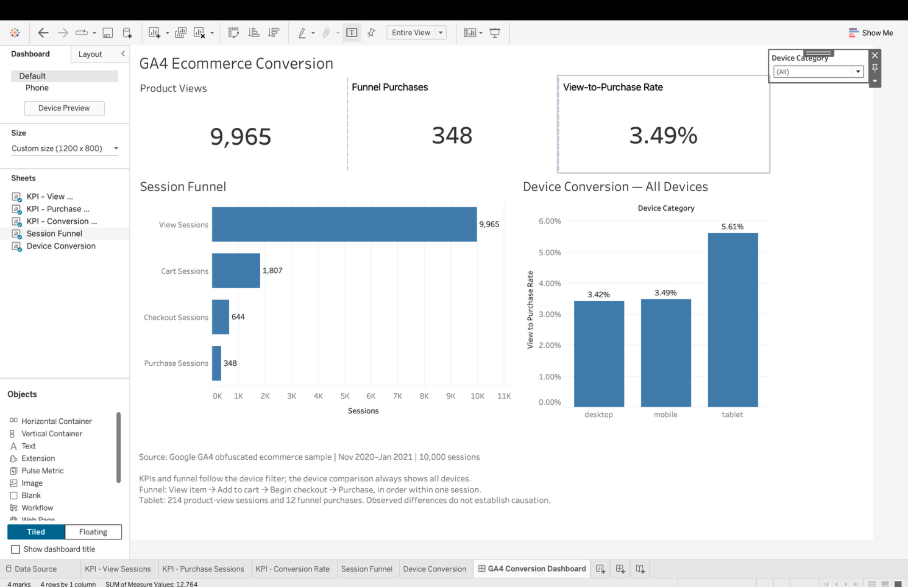
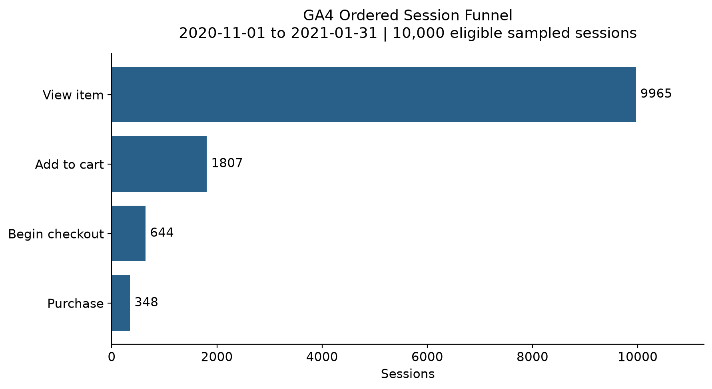
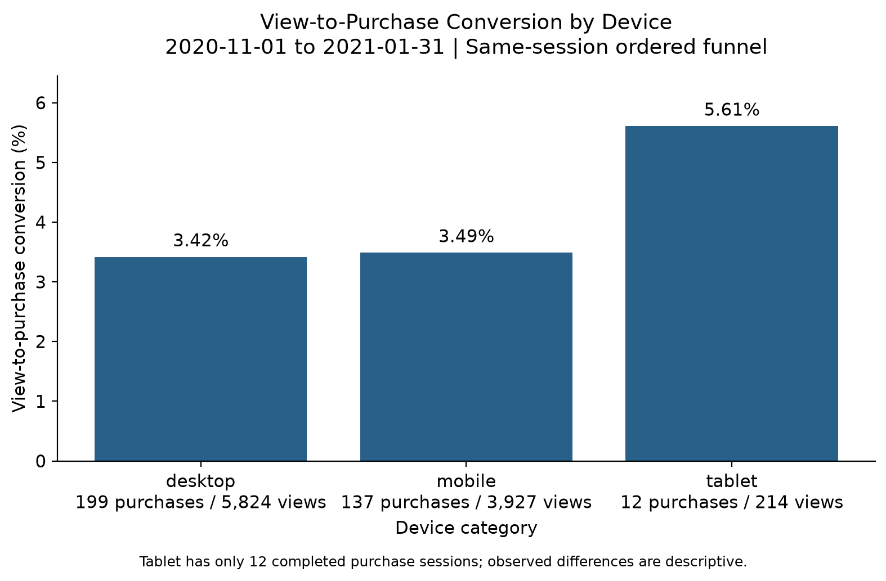

# GA4 Ecommerce Funnel Analysis

**BigQuery SQL → MySQL → Python/pandas → Tableau**

A reproducible portfolio project examining the same-session path from product view to purchase in Google's obfuscated ecommerce sample.

## Main findings

- **3.49%** of product-view sessions completed the ordered purchase funnel: **348 / 9,965**.
- **View → cart** had the largest adjacent-stage loss: **8,158 sessions (81.87%)**.
- Tablet conversion was **5.61%**, but only **12 / 214** view sessions completed the funnel. The ranking does not establish a stable or causal device advantage.

## Explore the project

- [Interactive Tableau Public dashboard](https://public.tableau.com/views/ga4_funnel_project_dashboard/GA4ConversionDashboard)
- [Executed analysis notebook](notebooks/01_ga4_data_quality.ipynb)
- [Business summary](BUSINESS_SUMMARY.md)
- [Download the packaged Tableau workbook](tableau/ga4_funnel_project_dashboard.twbx)
- [Validation and acceptance record](VALIDATION.md)
- [Data source and field dictionary](data/README.md)



## Business question

Where does the ordered shopping funnel lose the most sessions, and how does observed conversion differ by device? The goal is to prioritize investigation, rather than claim an optimization has already improved the business.

## Data and metric definitions

Source: [`bigquery-public-data.ga4_obfuscated_sample_ecommerce`](https://developers.google.com/analytics/bigquery/web-ecommerce-demo-dataset). Period: **November 1, 2020–January 31, 2021** (92 days). The checked-in snapshot has **10,000 rows and 25 columns**, with one row per pseudonymous user-session and composite key `user_pseudo_id + ga_session_id`.

**Population:** sessions containing at least one of six selected funnel events. Events are filtered before session aggregation and deterministic hash sampling. This is **not a sample of all website visits**. `session_date` is the earliest selected event date, rather than necessarily the session-start date.

Each stage must occur **strictly after** the preceding stage within the same session:

| Stage | Sessions | Conversion from previous stage |
|---|---:|---:|
| View item | 9,965 | — |
| Add to cart | 1,807 | 18.13% |
| Begin checkout | 644 | 35.64% |
| Purchase | 348 | 54.04% |

View-to-purchase conversion is **348 / 9,965 = 3.49%**. Purchases count sessions completing the full ordered sequence, rather than orders, all purchase events or unique customers. Rates are calculated before rounding to two decimal places.

| Device | View sessions | Funnel purchase sessions | View-to-purchase |
|---|---:|---:|---:|
| Desktop | 5,824 | 199 | 3.42% |
| Mobile | 3,927 | 137 | 3.49% |
| Tablet | 214 | 12 | 5.61% |




## What the project demonstrates

- **SQL:** extracting nested GA4 parameters without inflating event rows, aggregating to session grain, enforcing stage order, deterministic sampling, staging and device summaries.
- **Python:** identifier handling, missingness and duplicate checks, UTC parsing, event-count validation, saved MySQL reconciliation and visual communication.
- **Tableau:** a portable dashboard with three KPIs, a session funnel and a device comparison. The device selector filters KPIs and the funnel; the comparison retains all devices.

## Reproduce

Python 3.11+ is recommended. Create an isolated environment from the repository root:

```bash
python3 -m venv .venv
source .venv/bin/activate
python -m pip install -r requirements.txt
python -m ipykernel install --user --name ga4-funnel --display-name "GA4 Funnel"
python -m notebook
```

Open `notebooks/01_ga4_data_quality.ipynb`, choose the installed environment, and **Restart & Run All**. Starting Jupyter from either the repository root or `notebooks/` works. The notebook regenerates the Python CSVs and two PNG figures; it does not alter the source snapshot or saved MySQL TSV.

For a repeatable command-line run in the active environment:

```bash
python scripts/run_notebook.py
python scripts/validate_project.py
python scripts/check_public_release.py
```

The offline analysis uses the checked-in snapshot and a **saved MySQL export**. No BigQuery or MySQL credentials are required. Source SQL is included for independent re-extraction; re-running BigQuery may incur usage costs. This release does not claim that either database was reconnected during publication.

## Tableau workbook

Open `tableau/ga4_funnel_project_dashboard.twbx`. The package includes the `.twb`, CSV and Hyper extract, with relative internal paths. The companion `.twb` works when its `Data/` directory is retained.

- All: **9,965 views / 348 purchases / 3.49%**.
- Tablet: **214 views / 12 purchases / 5.61%**; funnel **214 → 31 → 13 → 12**.
- Returning to All restores the overall figures; the device comparison always shows all three devices.

The owner confirmed the packaged workbook opened without errors; tablet and All screenshots were reviewed against the numerical baseline. This was user-operated desktop acceptance, not an automated UI test.

## Repository structure

| Directory | Purpose |
|---|---|
| `data/` | Fixed snapshot, event dictionary and provenance |
| `sql/` | BigQuery extraction and MySQL validation/aggregation |
| `notebooks/` | Executed English presentation notebook |
| `results/` | Derived aggregates and saved MySQL export |
| `figures/` | Charts and dashboard preview |
| `tableau/` | Portable workbook and bundled data |
| `scripts/` | Notebook execution and release validation |

## Interpretation and limitations

Investigate view-to-cart first: validate tracking, then examine product availability, prices, traffic composition and add-to-cart interactions. These are hypotheses to test, not established explanations. Compare like-for-like segments and time periods before prioritizing a device change, then validate improvements experimentally.

The source is historical and obfuscated, with possible placeholder values and limited internal consistency. Internal validation does not prove complete tracking. Sessions are not independent customers, first-user source/medium are not current-session attribution, and `ANY_VALUE` dimension conflicts were not audited. No statistical significance, causal effect or realized conversion lift is claimed.

## Attribution

This is an independent educational portfolio analysis using Google's public GA4 sample. It is not affiliated with Google or Tableau. Third-party data and product names retain their respective rights; no new license is asserted over the source dataset.

- [Google dataset documentation](https://developers.google.com/analytics/bigquery/web-ecommerce-demo-dataset)
- [GA4 export schema](https://support.google.com/analytics/answer/7029846)
- [Tableau packaged workbooks](https://help.tableau.com/current/pro/desktop/en-us/save_savework_packagedworkbooks.htm)
